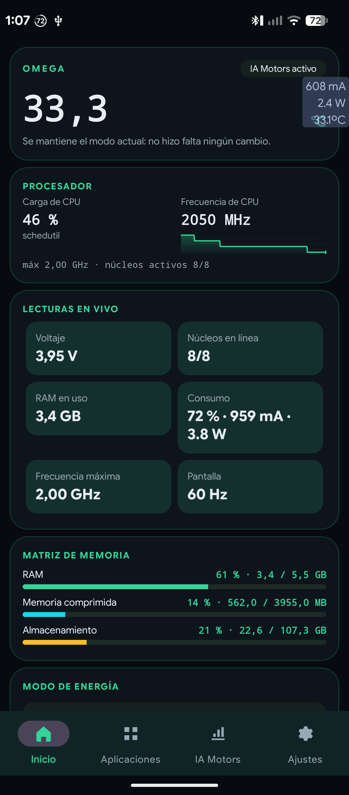
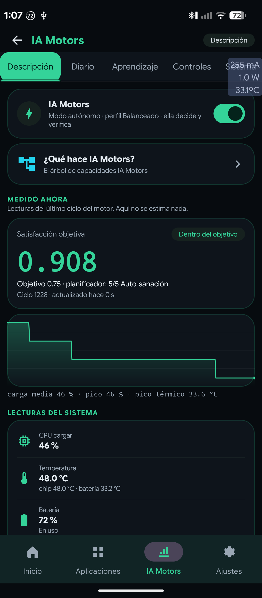
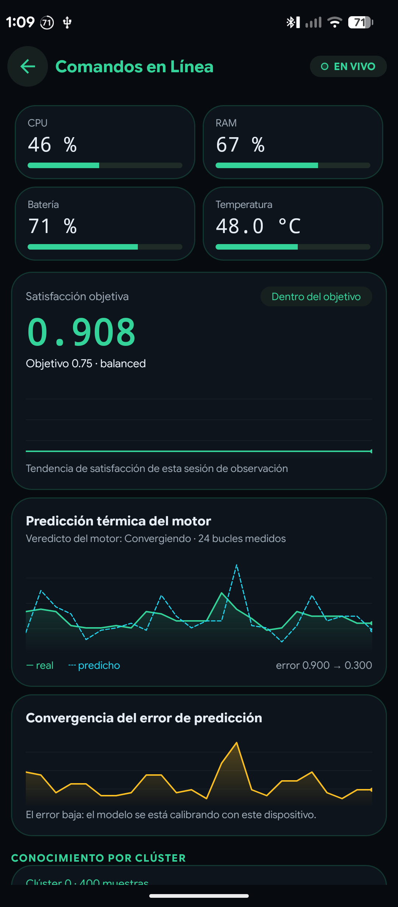
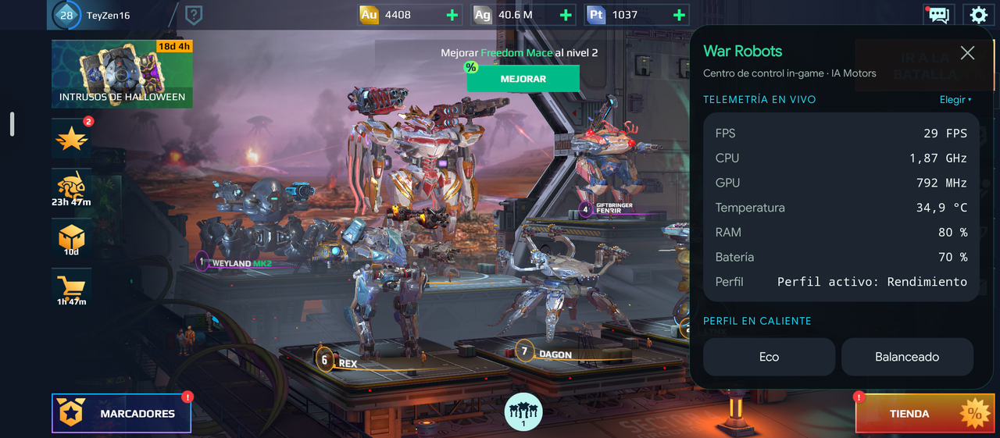

# IA Optimizer


-3DDC84?logo=android&logoColor=white)


**Optimizador adaptativo de rendimiento y batería para Android con root.**
Módulo *systemless* (KernelSU / Magisk / APatch) con un daemon en **Rust** de bajo
consumo y una **APK companion** en **Kotlin**, más una WebUI local embebida.
Sin nube, sin trackers, sin dependencias externas en el daemon: todo ocurre en el
dispositivo y solo se expone por *loopback*.

> Proyecto de TeyZen. Código propio bajo licencia **Apache-2.0**. Consulta [`NOTICE.md`](NOTICE.md)
> para la atribución de ideas de interfaz a proyectos Apache-2.0.

---

## Tabla de contenidos

- [Arquitectura](#arquitectura)
- [Características principales](#características-principales)
- [Requisitos](#requisitos)
- [Compilación desde el código fuente](#compilación-desde-el-código-fuente)
- [Instalación](#instalación)
- [Estructura del repositorio](#estructura-del-repositorio)
- [API local (resumen)](#api-local-resumen)
- [Seguridad y honestidad de las mediciones](#seguridad-y-honestidad-de-las-mediciones)
- [Aviso legal (disclaimer)](#aviso-legal-disclaimer)
- [Licencia](#licencia)

---

## Arquitectura

IA Optimizer es un sistema híbrido de tres piezas que cooperan en el dispositivo:

```
┌─────────────────────────────────────────────────────────────┐
│  APK companion (Kotlin, Views/XML)                          │
│  io.teyzen.iaoptimizer                                      │
│  · Inicio / Aplicaciones / IA Motors / Ajustes              │
│  · Game Space: panel in-game deslizable + HUD               │
│  · Habla con el daemon por HTTP loopback (127.0.0.1:8080)   │
└───────────────▲─────────────────────────────────────────────┘
                │ HTTP JSON (solo loopback)
┌───────────────┴─────────────────────────────────────────────┐
│  Daemon iaopt (Rust, std-only, ~1 MB)                       │
│  · Escaneo dinámico de nodos /sys y /proc                   │
│  · Motor adaptativo (IA Motors) con journal y aprendizaje   │
│  · Telemetría, perfiles, energía, herramientas del sistema  │
│  · WebUI embebida + API JSON                                │
│  · Escritura verificada: leer → escribir → releer → rollback│
└───────────────▲─────────────────────────────────────────────┘
                │ sysfs / procfs (root)
┌───────────────┴─────────────────────────────────────────────┐
│  Kernel del dispositivo (cpufreq, devfreq, thermal, battery)│
└─────────────────────────────────────────────────────────────┘
```

- **`iaopt-core`** (Rust): lógica pura y testeable — perfiles, sondeo de interfaces,
  motor de decisión y aplicación verificada. Sin E/S directa.
- **`iaopt-daemon`** (Rust): servidor HTTP mínimo sobre `TcpListener` (sin crates
  externos), estado, telemetría, gestión de energía, WebUI embebida y CLI.
- **`IAOptimizerApp`** (Kotlin): aplicación companion con interfaz nativa,
  `ViewBinding`, Material 3 y servicios en primer plano para el panel in-game y el HUD.

El módulo se instala como *systemless*: no modifica la partición del sistema. La APK
companion se incluye dentro del módulo (`system/app/IAOptimizer`) y se instala como
app de sistema; también puede compilarse e instalarse por separado.

---

## Características principales

### Telemetría y control en tiempo real
- Lectura dinámica de los nodos reales del kernel (`cpufreq`, `devfreq`, zonas
  térmicas, `kgsl`/`mali`, memoria, red, batería). **Solo se muestra lo que existe
  y es legible en tu dispositivo**: nada de interruptores falsos.
- Frecuencia de CPU por clúster (núcleo activo más alto), GPU, RAM, ZRAM,
  almacenamiento, temperatura, voltaje, corriente y refresco de pantalla en vivo.
- Gráficos de tendencia (sparklines) dibujados en Canvas, sin librerías pesadas.

### Perfiles automáticos y motor IA Motors
- Perfiles **Eco / Balanceado / Rendimiento** con histéresis para no oscilar.
- **IA Motors**: agente autónomo que mide la satisfacción del objetivo, propone el
  cambio mínimo suficiente, lo verifica con relectura, mide el resultado y aprende
  qué controles enfrían o calientan. Journal de decisiones y autoauditoría.
- Conmutación por contexto (juego, vídeo, pantalla apagada, temperatura, batería).
- Interruptor maestro: con IA activa, las escrituras manuales se bloquean en el
  backend (no solo en la UI); al desactivarla se restaura el estado previo exacto.

### Game Space y panel in-game
- Panel lateral deslizable sobre el juego con telemetría en vivo y **widgets
  configurables por juego** (FPS, CPU, GPU, temperatura, RAM, batería, perfil).
- Cambio de perfil en caliente, modo No Molestar, bloqueo de brillo y HUD flotante.
- **FPS real** del display (contadores de SurfaceFlinger, compatible con juegos
  Vulkan donde `gfxinfo` no reporta) y **grabadora de sesiones** (CSV + resumen con
  media, mínimo, peor 1 % y jank, con granularidad declarada).
- Los ajustes de confort guardan el estado previo y lo restauran al salir del juego.

### Gestión de energía
- **Carga directa (bypass térmico)**: alimenta el móvil desde el cargador reduciendo
  el calor; nodos del fabricante detectados y probados con escritura + relectura +
  restauración. Los nodos de riesgo solo se prueban, no se activan.
- **Límite de carga** y **carga inteligente** (mantiene un objetivo y aprende la hora
  habitual de desenchufe). Verificación de **efecto físico** (corriente/contador),
  no solo de escritura: si el corte no se sostiene, se avisa con honestidad.
- **Detector de cargador bloqueado**: avisa si el cargador está conectado pero no
  entra corriente (negociación PD/PE fallida o cable defectuoso).
- Gestión del temporizador de seguridad de carga del vendor.

### Herramientas del sistema
- Escáner LAN (ARP + ping), uso de apps, permisos (appops), recorte `fstrim`,
  limpieza de cachés, clips de pantalla, copia de seguridad y consola de registro.
- Monitor de tareas por consumo de CPU.

---

## Capturas de pantalla

| Inicio | IA Motors | Comandos en Línea | Panel in-game |
|:---:|:---:|:---:|:---:|
|  |  |  |  |

Más vistas: [Controles por tarjetas](docs/screenshots/03-controles.png) · [Energía / Fuerza](docs/screenshots/05-fuerza-energia.png) · [Batería en vivo](docs/screenshots/04-fuerza-bateria.png) · [Aplicaciones](docs/screenshots/08-aplicaciones.png) · [Conocimiento por clúster](docs/screenshots/07-comandos-conocimiento.png).

---

## Requisitos

| Componente | Requisito |
|---|---|
| Dispositivo | Android 8.0+ (API 26), arquitectura `arm64-v8a` |
| Root | KernelSU, KernelSU Next, Magisk o APatch |
| Para compilar el daemon | Rust (stable) + target `aarch64-linux-android` + Android NDK |
| Para compilar la APK | JDK 17 + Android SDK (compileSdk 35); Gradle 8.10.2 vía wrapper |

> Sin root, el escaneo y la WebUI de lectura funcionan, pero no se puede escribir
> en los nodos del kernel.

---

## Compilación desde el código fuente

### 1. Daemon en Rust (aarch64-linux-android)

```bash
# Target de Android
rustup target add aarch64-linux-android

# Linker del NDK (ajusta la ruta/version a tu NDK instalado)
export CARGO_TARGET_AARCH64_LINUX_ANDROID_LINKER="$ANDROID_HOME/ndk/<version>/toolchains/llvm/prebuilt/linux-x86_64/bin/aarch64-linux-android21-clang"
# En Windows el driver es .cmd y la carpeta prebuilt es windows-x86_64.

# Compilar el binario iaopt
cargo build --release --target aarch64-linux-android -p iaopt-daemon
# Binario: target/aarch64-linux-android/release/iaopt
```

### 2. APK companion (Kotlin/Gradle)

```bash
cd IAOptimizerApp
# El wrapper descarga Gradle 8.10.2 automáticamente.
./gradlew assembleDebug          # Linux/macOS
gradlew.bat assembleDebug        # Windows
# APK: app/build/outputs/apk/debug/app-debug.apk
```

Define `ANDROID_HOME` (o crea `local.properties` con `sdk.dir=...`, ignorado por Git).
En Windows también puedes usar el script parametrizado `build_app.ps1`
(acepta `-JavaHome`, `-GradleHome`, `-AndroidHome`).

### 3. Empaquetado del módulo flasheable

```powershell
# Windows: compila el daemon y empaqueta el zip del módulo con la APK dentro.
powershell -ExecutionPolicy Bypass -File build.ps1
# -> build/IA_Optimizer-vX.Y.Z.zip
```

`build.ps1` usa `tar.exe` (bsdtar) para que las entradas del zip usen separador `/`,
como espera Magisk/KernelSU. Requiere el NDK y la APK ya compilada.

---

## Instalación

1. Flashea `build/IA_Optimizer-vX.Y.Z.zip` en tu gestor root (KernelSU/Magisk/APatch)
   y reinicia.
2. El daemon arranca solo desde `service.sh`. En **KernelSU**, la tarjeta del módulo
   muestra el botón **Abrir** que lanza la WebUI (si no aparece, desactiva/activa el
   módulo o reinicia: el gestor cachea la lista de webroots).
3. La APK companion se instala como app de sistema; ábrela para usar IA Motors,
   Game Space y el panel in-game.
4. WebUI en navegador: `http://127.0.0.1:8080` (o `adb forward tcp:18080 tcp:8080`).
5. Al desinstalar el módulo, `uninstall.sh` detiene el daemon y borra su estado.

---

## Estructura del repositorio

```
IA_Optimizer/
├── module.prop              # metadatos del módulo (id, versión, autor)
├── customize.sh             # instalación systemless
├── post-fs-data.sh          # arranque temprano + anti-bootloop
├── service.sh               # arranque del daemon en boot_completed
├── action.sh                # deep link a la app companion
├── uninstall.sh             # limpieza al desinstalar
├── build.ps1                # compila daemon + empaqueta el zip
├── iaopt-core/              # lógica Rust pura (perfiles, sondeo, motor)
├── iaopt-daemon/            # daemon Rust: HTTP, estado, telemetría, WebUI
│   └── webui/               # WebUI embebida (HTML/JS)
├── IAOptimizerApp/          # APK companion Kotlin (Gradle)
│   ├── app/src/main/        # código y recursos
│   ├── gradle/wrapper/      # wrapper de Gradle
│   └── build_app.ps1        # script de compilación parametrizado
├── tools/                   # despliegue y verificación por adb
├── docs/                    # documentación (las notas internas de sesión no se publican)
├── NOTICE.md                # atribución de terceros (Apache-2.0)
├── LICENSE                  # Apache-2.0
└── README.md
```

---

## API local (resumen)

El daemon expone JSON por `127.0.0.1:8080` (solo loopback). Endpoints principales:

| Método | Ruta | Descripción |
|---|---|---|
| GET | `/api/state` | perfil, modo automático, telemetría y nº de controles |
| GET | `/api/scan` | interfaces del kernel detectadas (con rangos) |
| GET | `/api/telemetry` | telemetría completa (CPU, GPU, memoria, red, batería) |
| GET | `/api/history` | historial para los gráficos |
| GET | `/api/agent` | actividad de IA Motors, plan, aprendizaje y errores |
| POST | `/api/ai/toggle` | activa/desactiva la IA autónoma |
| POST | `/api/profile` | aplica `eco` / `balanced` / `performance` |
| POST | `/api/knob` | escritura verificada de un nodo `{path, value}` |
| GET | `/api/bypass` | estado de carga directa (nodos, cargador, umbral) |
| GET/POST | `/api/charge` | límite de carga, carga inteligente y temporizador |
| GET | `/api/charge-nodes` | inventario de nodos de carga del vendor |
| GET | `/api/fps?package=X` | FPS real del display por paquete |
| GET/POST | `/api/recorder` | grabadora de sesiones de juego |
| GET/POST | `/api/session` | sesión in-game (perfil, DND, brillo, FPS) |
| GET | `/api/apps?filter=` | aplicaciones instaladas con ajustes |
| GET | `/api/games` | apps marcadas como juego |
| GET | `/api/command_center` | centro de comando en vivo |
| GET | `/api/warnings` | nodos que el kernel rechazó (honestidad) |
| GET | `/api/selftest`* | (*selftest es subcomando CLI: `iaopt selftest`) |

CLI del binario: `iaopt serve | scan | state | telemetry | selftest | device | …`
(`iaopt --help` para la lista completa).

---

## Seguridad y honestidad de las mediciones

- **Solo loopback**: el daemon nunca se expone a la red. La WebUI de KernelSU usa
  `ksu.exec`, no sockets de red.
- **Escaneo honesto**: no se escribe ninguna ruta que no exista o no sea escribible.
  Un control ausente en el escaneo es una característica funcionando correctamente.
- **Verificación por relectura + rollback**: cada escritura se relee y se exige que el
  valor se sostenga; si el daemon de potencia del vendor lo revierte, se reporta como
  fallo y se restaura el valor previo. Nunca se dice "aplicado" si no se sostuvo.
- **Verificación de efecto físico** en energía: el corte de carga se comprueba con la
  corriente/contador reales, no solo con la relectura del nodo.
- **Restauración exacta**: los ajustes de sesión (DND, brillo, FPS) y el interruptor
  maestro guardan el estado previo y lo restauran, incluso tras un crash del daemon.
- **Anti-bootloop**: `post-fs-data.sh` cuenta arranques fallidos y desactiva el módulo
  si el daemon muere repetidamente; el contador se reinicia en arranques buenos.
- **Sin telemetría externa**: no hay nube, ni analytics, ni conexiones salientes.
- **Nodos de riesgo**: los nodos de carga peligrosos solo pueden probarse (escritura +
  relectura + restauración), nunca activarse a ciegas.

---

## Aviso legal (disclaimer)

> ⚠️ **IA Optimizer modifica parámetros del kernel en un dispositivo con root.**
>
> - Se proporciona **"tal cual"**, sin garantía de ningún tipo (ver [`LICENSE`](LICENSE)).
>   En ningún caso los autores serán responsables de daños, pérdida de datos,
>   *bootloops*, degradación de batería o cualquier perjuicio derivado del uso.
> - Escribir en nodos de frecuencia, térmica o carga puede afectar a la estabilidad,
>   la temperatura y la vida útil de la batería. Úsalo bajo tu propia responsabilidad.
> - Aunque el módulo incluye verificación, rollback y anti-bootloop, **ningún software
>   puede garantizar la seguridad en todos los kernels y dispositivos**. Haz copia de
>   seguridad antes de instalar y prueba primero los perfiles conservadores.
> - La carga directa y el límite de carga dependen del hardware: en algunos
>   dispositivos el corte puede no sostenerse físicamente; el módulo lo indica en vez
>   de fingir que funciona. No fuerces nodos de riesgo.
> - Rootear y flashear módulos puede anular la garantía de tu dispositivo.

---

## Licencia

Código propio de TeyZen bajo licencia **Apache License 2.0** — ver [`LICENSE`](LICENSE).
Apache-2.0 es una licencia permisiva que incluye concesión explícita de patentes y
exige conservar el fichero [`NOTICE.md`](NOTICE.md) y los avisos de atribución al
redistribuir, así como indicar los ficheros modificados.

Las ideas de interfaz (tarjetas por categoría) y la lista de rutas de carga bypass se
inspiraron en **AZenith** (Apache-2.0, Zexshia) y sus referentes **Encore Tweaks**
(Apache-2.0, Rem01Gaming) y **Rianixia-ThermalCore** (Apache-2.0, Ryanistr).
**No se copió código fuente ni binarios** de esos proyectos: la implementación es
original. Atribución completa en [`NOTICE.md`](NOTICE.md).